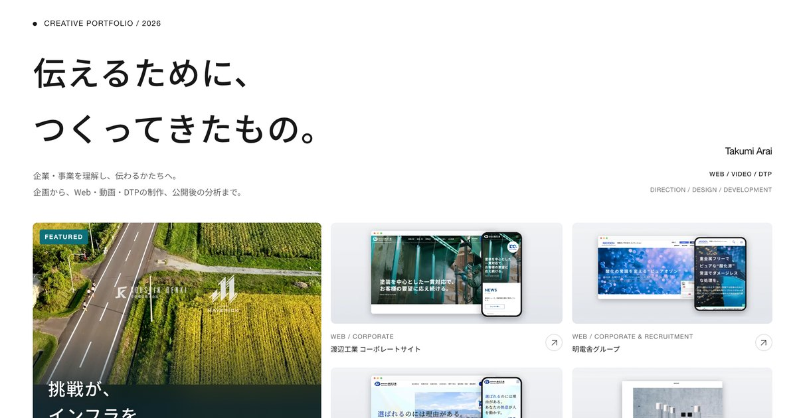

# 新井拓海 ポートフォリオ — Takumi Arai Portfolio

Web・動画・DTP のディレクター、新井拓海のポートフォリオサイトです。採用サイト・コーポレートサイト・採用動画・パンフレットなど 20 件の制作実績を、課題・判断・結果とあわせて紹介しています。

**▶ サイトを見る: https://takumii-arai.github.io/takumi-arai-portfolio/**

## 掲載している内容

- **制作実績 20 件**（2023〜2026年）: 企業・採用サイト、採用動画、パンフレット・カタログなどの DTP、採用広報の企画まで。
- 各実績の詳細では、**課題 → 判断 → その理由 → 結果** の順に、担当範囲と制作体制をあわせて紹介しています。
- 注目のプロジェクト: **幸信電気 スポンサー活用プロジェクト**（対談動画・採用特設 LP・転職フェアのツール・プレス発信を一つのメッセージでつないだ取り組み）。

## 見方

- PC・スマートフォンのどちらでもご覧いただけます。
- 「制作実績」の絞り込み（ディレクション／デザイン／コーディング／撮影・動画／DTP・資料）で、担当領域ごとに実績を探せます。
- 実績のカードを選ぶと、詳細（画像・担当範囲・判断の理由）が開きます。
- ページ冒頭の「モーションをオフ」、または端末の「視差効果を減らす」設定で、動画やアニメーションを止めて閲覧できます。

## 掲載作品について

- 掲載している制作物（サイト・動画・印刷物）の著作権・商標・肖像などの権利は、各企業・各権利者に帰属します。
- 画像・文章の転載、二次利用はご遠慮ください。
- 制作はいずれもチームでの取り組みです。外部のデザイナー・カメラマン・コーダーなどが担当した工程は、各実績の詳細に記載しています。

## このリポジトリについて

サイトを公開するためのリポジトリです（HTML・CSS・JavaScript、GitHub Pages）。サイトの内容に関するご連絡は、GitHub のプロフィール（[@takumii-arai](https://github.com/takumii-arai)）からお願いします。

© 2026 Takumi Arai
